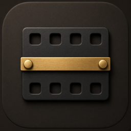
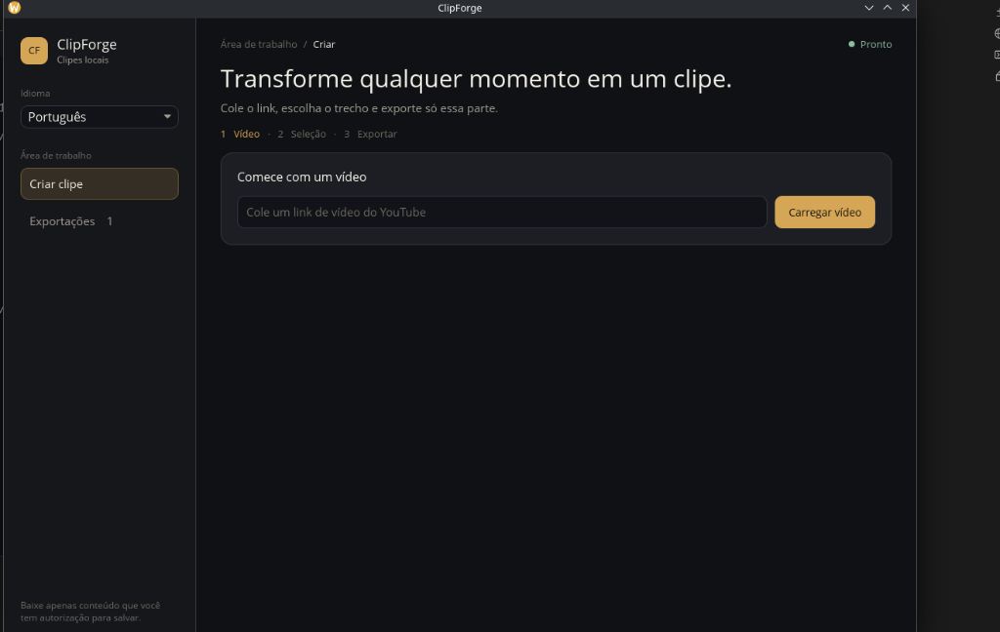
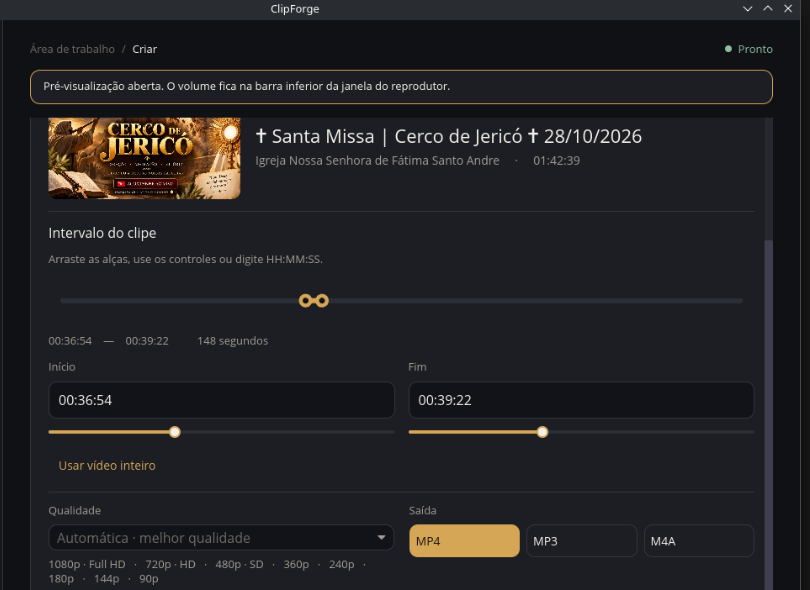

# ClipForge

<p align="center">
  
</p>

ClipForge is an open-source Linux desktop application for selecting and exporting video clips. The project is in active early development.

<p align="center">
  
</p>

<p align="center">
  
</p>

## Status

- Quality choices are displayed in familiar terms such as 1080p · Full HD and 720p · HD, with the highest available resolutions first.
- Preview and export show explicit loading/processing states; export also reports progress, speed, and ETA when available.
- Current features include metadata lookup, thumbnail display, range selection, MP4/MP3/M4A section export, cancellation, retry, and recent-export history. MPV/FFplay preview is external; embedded playback is not implemented.

## Stack

- Rust 2024
- Iced 0.14
- yt-dlp for authorized video metadata/downloads (required for media operations)
- FFmpeg for media processing (required for export)

The UI delegates expensive work to asynchronous tasks. External tools run as child processes with argument arrays, not shell command strings. MP4 video and MP3/M4A audio export options are available; existing destination files are never overwritten.

## Build

Install Rust stable and Linux graphics/window-system development dependencies required by Iced/wgpu for your distribution, then run:

```sh
cargo build
cargo run
```

Install `yt-dlp`, `ffmpeg`, and Deno from trusted distribution packages before metadata lookup/export. Deno is the recommended JavaScript runtime for current yt-dlp releases; without it, YouTube may expose fewer formats or extraction may fail. MPV is optional; FFplay is used as a preview fallback when available.

## Using ClipForge

1. Paste a supported YouTube URL and load metadata.
2. Adjust start/end times using the time fields or sliders.
3. Select a resolution (or keep the automatic best-quality option), choose MP4 video, MP3 audio, or M4A audio, set a destination, and export. Status and progress update during download and processing; failed exports can be retried from the current form values.

## Preview decision

ClipForge opens an external preview window. MPV plays the selected range directly when installed. Otherwise, yt-dlp resolves the selected media streams, FFmpeg seeks to the interval and pipes a stream-copy preview to FFplay; this avoids downloading the full video but can begin at a nearby keyframe. Playback controls and seeking are not synchronized back to the timeline. Native embedding remains deferred because libmpv requires a render bridge to Iced/wgpu, while GStreamer adds plugin/runtime packaging and surface-embedding requirements.

## Responsible use

Use ClipForge only for content you own or are authorized to download. Respect copyright and platform terms. ClipForge will not implement DRM or access-control circumvention.

## Distribution

A tagged release publishes a Linux x86_64 binary, so running ClipForge does not require Rust. `yt-dlp`, FFmpeg, and a preview player remain separate installs. Details and the formats still under evaluation are in [DISTRIBUTION.md](DISTRIBUTION.md).

## Contributing

See [CONTRIBUTING.md](CONTRIBUTING.md) for development checks and pull request guidance.

## License

MIT. See [LICENSE](LICENSE).
